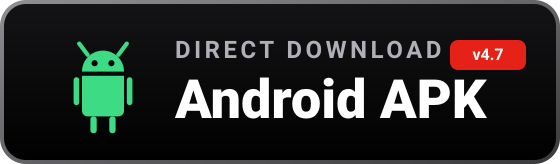
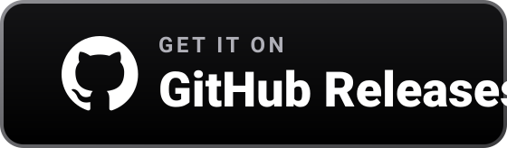
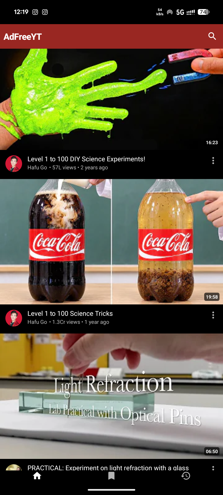
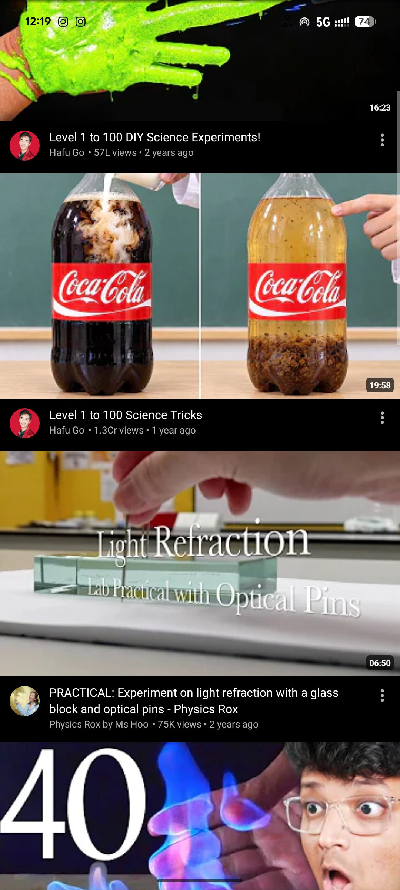
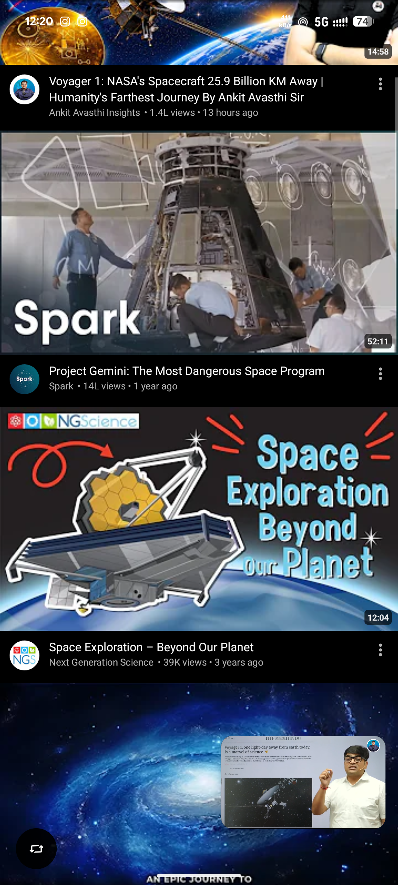
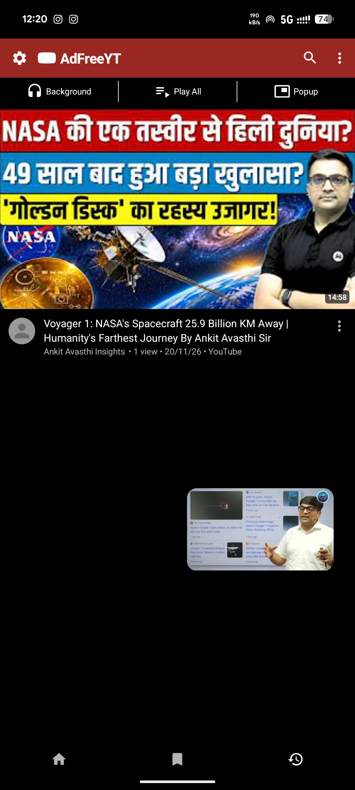
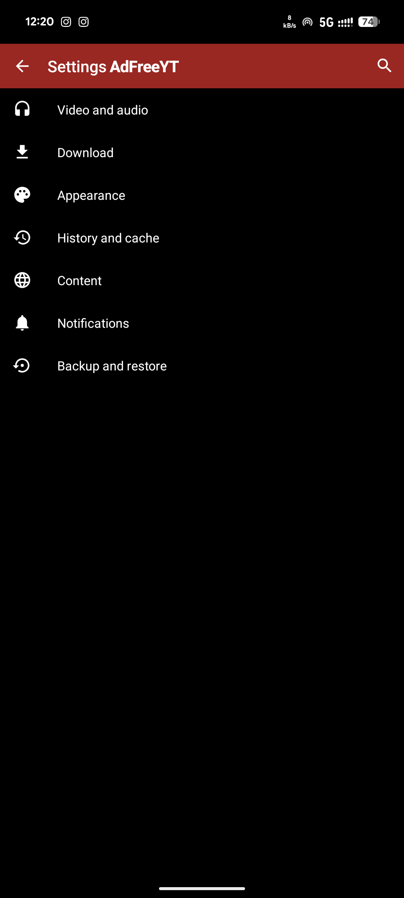

<div align="center">

# 🎬 AdFreeYT

[](https://github.com/Bit-manipulators/youtube-without-ads/actions)
[](https://github.com/Bit-manipulators/youtube-without-ads/releases/latest)
[](https://github.com/Bit-manipulators/youtube-without-ads/releases/latest)

<br/>

<!-- BIG ORIGINAL DOWNLOAD BUTTON -->
<a href="https://github.com/Bit-manipulators/youtube-without-ads/releases/latest/download/AdFreeYT_v4.16.apk">
  
</a>

<br/>
<br/>

<!-- OFFICIAL STORE / GITHUB BADGES -->
<a href="https://github.com/Bit-manipulators/youtube-without-ads/releases/latest/download/AdFreeYT_v4.16.apk">
  
</a>
&nbsp;&nbsp;
<a href="https://github.com/Bit-manipulators/youtube-without-ads/releases/latest">
  
</a>

<p align="center">
  <a href="#-screenshots">Screenshots</a> •
  <a href="#-key-features">Key Features</a> •
  <a href="#-installation-guide">Installation</a> •
  <a href="#-comparison">Why AdFreeYT?</a> •
  <a href="#-license--credits">Credits</a>
</p>

---

</div>

## 📱 Screenshots

<div align="center">
<table>
  <tr>
    <td align="center"><b>Home Feed (AMOLED Black)</b></td>
    <td align="center"><b>Immersive Auto-Hide Scroll</b></td>
    <td align="center"><b>In-App Mini Floating Player</b></td>
  </tr>
  <tr>
    <td></td>
    <td></td>
    <td></td>
  </tr>
  <tr>
    <td align="center"><b>History & Top Actions</b></td>
    <td align="center"><b>AMOLED Black Settings</b></td>
    <td align="center"><b>Video Player & Details</b></td>
  </tr>
  <tr>
    <td></td>
    <td></td>
    <td></td>
  </tr>
</table>
</div>

## 🌟 Key Features

<table>
  <tr>
    <td width="50%">
      <h3>🚫 100% Ad-Free</h3>
      Enjoy YouTube uninterrupted. No video ads, audio ads, sponsored banners, or popups.
    </td>
    <td width="50%">
      <h3>🎵 Background & Lockscreen Audio</h3>
      Listen to podcasts, music, and videos with your screen off or while multitasking in other apps.
    </td>
  </tr>
  <tr>
    <td width="50%">
      <h3>🖼️ Picture-in-Picture (PiP)</h3>
      Keep streaming in a smooth, resizable floating popup window anywhere on your device.
    </td>
    <td width="50%">
      <h3>📱 Real YouTube Interface</h3>
      Redesigned modern card feed, branded top navigation bar, and Home/Save/History bottom tabs with animated auto-hide on scroll.
    </td>
  </tr>
  <tr>
    <td width="50%">
      <h3>🔒 Private by Design</h3>
      No Google account or Play Services required. Your watch history, bookmarks, and subscriptions remain securely on your device.
    </td>
    <td width="50%">
      <h3>💾 Offline Downloads</h3>
      Download high-definition video (up to 4K 60fps HDR), standalone audio (M4A/Opus), and subtitles directly to your local storage.
    </td>
  </tr>
</table>

---

## 🚀 What's New in v4.16

- **Mention Versioned APK in README & CI Automation**: README download links and Termux curl commands explicitly mention the versioned APK (`AdFreeYT_v4.16.apk`), automated on each release via GitHub Actions CI.
- **Fixed Detail Dock Blank Panel Glitch**: Detail dock now correctly remains hidden while scrolling related videos, description, or comments; eliminates the empty dark pill panel glitch by keeping tab visibility and icons synchronized.
- **Fixed Bottom Dock on Video Page**: Main bottom dock now hides completely and reliably when clicking and playing any video; stays hidden while video details and comments are open.
- **Swipe Gestures to Fullscreen Landscape & Mini Floating Window**: Swiping up on the video player enters fullscreen in landscape mode; swiping down minimizes to the in-app floating window.
- **3-Zone Fullscreen Controls**: Fullscreen landscape screen divided into 3 zones — Left 1/3 for brightness, Middle 1/3 for swipe-down minimize/exit fullscreen, Right 1/3 for volume.

---

## 📥 Installation Guide

### Option 1: Direct Download (Standard Android)

1. Tap the [**Big Download Button**](https://github.com/Bit-manipulators/youtube-without-ads/releases/latest/download/AdFreeYT_v4.16.apk) above or visit [Releases](https://github.com/Bit-manipulators/youtube-without-ads/releases/latest).
2. Download `AdFreeYT_v4.16.apk`.
3. Open the downloaded file and select **Install** (allow "Install from Unknown Sources" if prompted).

### Option 2: Termux

If you are running Termux with storage permission:

```bash
# Download latest release directly
curl -L -o AdFreeYT_v4.16.apk https://github.com/Bit-manipulators/youtube-without-ads/releases/latest/download/AdFreeYT_v4.16.apk

# Install via Android Package Installer
termux-open AdFreeYT_v4.16.apk
```

---

## 📊 Why AdFreeYT?

| Feature | Official YouTube | AdFreeYT |
| :--- | :---: | :---: |
| **No Video Ads** | ❌ (Requires Premium) | ✅ **Built-in & Free** |
| **Background Playback** | ❌ (Requires Premium) | ✅ **Included** |
| **Picture-in-Picture** | ⚠️ (Region / Premium locked) | ✅ **Always Enabled** |
| **Local Video & Audio Downloads** | ❌ (Encrypted in-app only) | ✅ **Full MP4 / M4A / WebM files** |
| **Google Account Required** | ⚠️ Yes | ❌ **No Account Needed** |
| **App Size** | ~150+ MB | **~16 MB** |

---

## 🛠️ Building from Source

```bash
git clone -b newpipe https://github.com/Bit-manipulators/youtube-without-ads.git
cd youtube-without-ads
./gradlew assembleContinuous
```

The output APK will be generated at `app/build/outputs/apk/continuous/app-continuous.apk`.

---

## 📜 License & Credits

- Built with ❤️ based on the open-source [NewPipe](https://github.com/TeamNewPipe/NewPipe) project.
- Licensed under the **[GNU General Public License v3.0](LICENSE)**.
